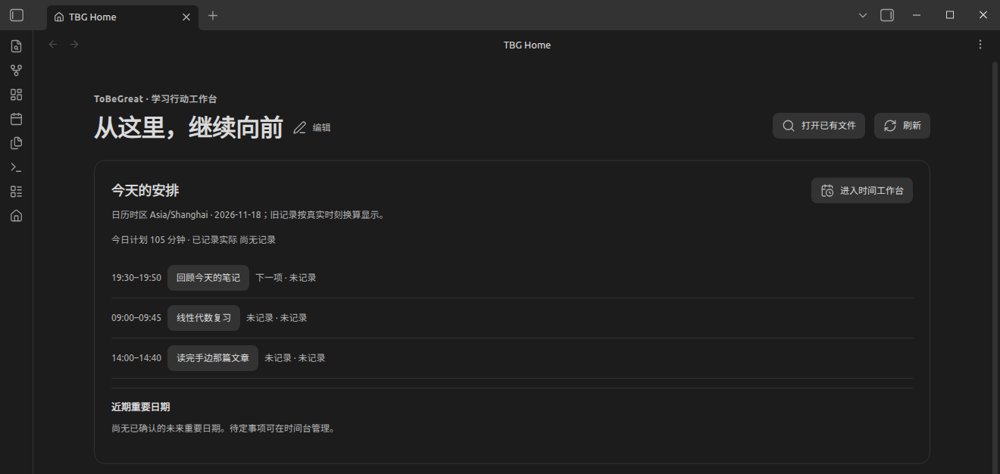
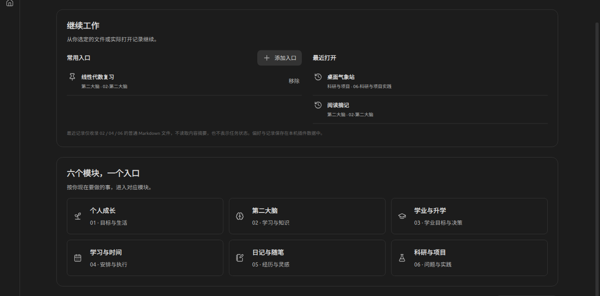
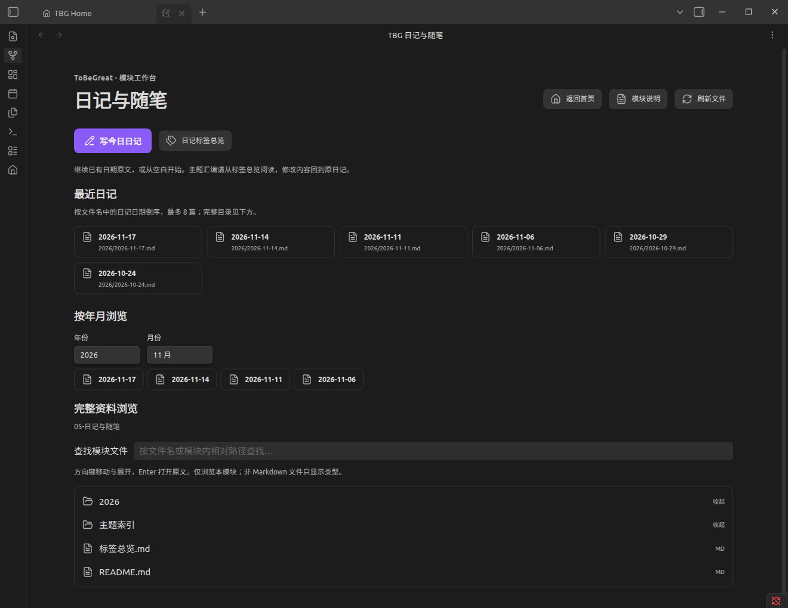

# Obsidian Growth Hub

打开 Obsidian，先看今天有什么安排，再接着读上次那份笔记。这个仓库发布的是 **ToBeGreat Starter**，一个可以直接打开的 Obsidian Vault。里面有六个工作区、常用 Markdown 模板，以及随包提供的 TBG Home 和 TBG 日记主题汇编。

**[下载 ToBeGreat Starter 2.0 RC2](https://github.com/xcg-123/Obsidian-Growth-Hub/releases/download/v2.0.0-rc.2/ToBeGreat-Starter-2.0-RC2.zip)** · [查看版本说明](https://github.com/xcg-123/Obsidian-Growth-Hub/releases/tag/v2.0.0-rc.2)

## 打开以后

首页的「今天的安排」汇集当天的时间块和近期重要日期。点「进入时间工作台」可以按日、周、月查看，打开一项安排就能调整时段或补记实际用时。首页标题也可以改成自己习惯的叫法。

经常回看的课程笔记和项目文件可以加入「常用入口」。忘了上次打开哪篇，就看看旁边的「最近打开」。

| 模块 | 可以记什么 |
| --- | --- |
| 个人成长 | 给一个目标定下完成标准，留下下一步和之后的复盘。 |
| 第二大脑 | 按课程或主题整理知识笔记，给读到一半的章节设个检查点。 |
| 学业与升学 | 记录学业目标和已核实的事实，把升学选项、依据和疑问记在一起。 |
| 学习与时间 | 排好这周的时间，回头补上实际做了多久。 |
| 日记与随笔 | 写下当天的经历和想法，之后按年月或标签找回。 |
| 科研与项目 | 为一篇论文或一个项目建主记录，后续把阅读笔记和实验观察接着写。 |

## 写日记

点「写今日日记」就会打开当天的 Markdown 文件。过几个月想找回一段记录，可以按年月翻，也可以从「日记标签总览」查看同一个主题下的内容。

在日记里，每条记录用二级标题开头。在标题下面另起一行写 `标签：阅读 灵感`，主题汇编插件就会把这一条正文汇入对应主题。要改内容时，回到当天的原文编辑。

*截图中的安排、文件和日记均为演示数据。Starter 从空白记录开始。*

## 安装

1. 安装 **Obsidian 1.8.7 或更新版本**，然后完整解压下载的 ZIP。[下载 Obsidian](https://obsidian.md/download)
2. 在 Obsidian 选择「打开文件夹作为仓库」，选中同时含 `README.md` 和 `.obsidian` 的内层文件夹。
3. 打开「设置 → 第三方插件」，按 Obsidian 的提示授权，然后启用 **TBG Home** 和 **TBG 日记主题汇编**。两款插件已在包里。
4. 在命令面板运行 **TBG Home: 打开首页**，也可以点桌面端左侧的房屋图标。接下来可以先安排一个时间块，或者写第一篇日记。

笔记、计划和项目记录都保存在 Vault 的 Markdown 文件里，关闭插件后仍可直接阅读和编辑。时间工作台目前使用 `Asia/Shanghai` 时区，今日日记使用设备的本地日期。安装细节和各平台注意事项见包内 `README.md`。
